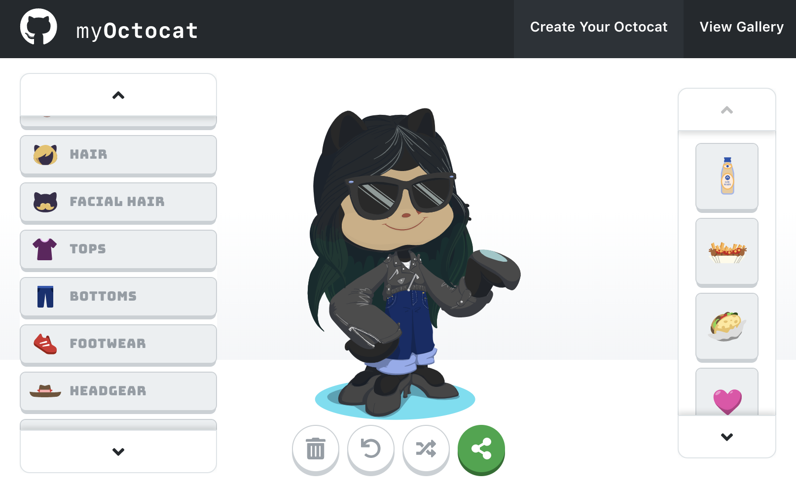

# 欢迎来到 GitHub

欢迎来到 GitHub——数百万开发者在这里协作开发软件。准备好开始了吗？我们会通过搭建并发布你的第一个 GitHub Pages 网站，带你了解这一切是如何运作的！

## 仓库（Repositories）

现在，你正处在你的第一个 GitHub **仓库**里。仓库就像是项目的文件夹或存储空间。你的项目仓库包含所有文件，例如代码、文档、图片等等。它还会记录你——或你的协作者——对每个文件所做的每一次修改，这样即使你犯了错，也随时可以回到之前的版本。

这个仓库包含三个重要文件：你在 GitHub 上第一个网站的 HTML 代码、为网站添加颜色与字体的 CSS 样式表，以及 **README** 文件。它还有一个图片文件夹，里面有一张图片。

## 描述你的项目

你当前正在查看项目的 **README** 文件。**_README_** 文件就像是项目的封面或电梯演讲。它们用纯文本或 [Markdown 语言](https://guides.github.com/features/mastering-markdown/) 编写，通常包含一段项目简介、使用说明、作者信息等等。

[进一步了解 README](https://help.github.com/en/articles/about-readmes)

## 你的第一个网站

**GitHub Pages** 是一项免费而简单的方式，可以用你 GitHub 仓库中的代码创建网站。你可以用 GitHub Pages 展示作品集、创建个人网站，或与世界分享你编写的有趣项目。这个仓库已自动启用 GitHub Pages；不过将来创建新仓库时，启动 GitHub Pages 网站的步骤会略有不同。

[进一步了解 GitHub Pages](https://pages.github.com/)

## 重命名此仓库以发布你的站点

我们已经根据你的个人用户名，为你配置好了 GitHub Pages 网站。这个仓库目前叫 `hello-world`，你需要把它重命名为 `username.github.io`，以匹配你网站的 URL 地址。如果仓库名的第一部分与你的用户名不完全一致，网站就无法正常工作，所以务必确保拼写正确。

让我们开始吧！要更新仓库名称，请点击页面上的 `Settings`（设置）标签页，这会带你进入仓库的设置页面。


在 **Repository Name**（仓库名称）标题下输入：`username.github.io`，其中 username 是你在 GitHub 上的用户名。然后点击 **Rename**（重命名）——就这样。完成后，点击你的仓库名或浏览器的返回按钮，回到本页面。


点击 **Rename** 后，你的网站会自动发布到：https://your-username.github.io/ 名为 `index.html` 的 HTML 文件会作为首页渲染，下一步你将修改这个文件。

恭喜！你刚刚发布了第一个 GitHub Pages 网站，现在可以向全世界分享了。

## 进行第一次编辑

当你对项目中的任何文件做出修改时，你就是在进行一次**提交（commit）**。无论是修正错别字、更新文件名，还是编辑代码，你都可以把它作为一次提交添加到 GitHub。你的提交代表了项目的完整历史——它们都会保存在项目仓库中。

每次提交时，你都可以写一条**提交信息（commit message）**，用简短而有意义的说明描述你对文件所做的修改。这样无论何时回到某次提交，你都能清楚知道改了什么。

## 练习：用 HTML 代码定制你的第一个 GitHub 网站

想编辑刚刚发布的站点吗？让我们通过在 `index.html` 文件中介绍自己，来练习提交。不用担心第一次就写得完美——你随时可以在之后继续完善你的自我介绍。

从这个模板开始：

```
<p>Hello World! I’m [username]. This is my website!</p>
```

要添加你的自我介绍，请复制我们的模板，然后点击 `index.html` 文件右上角的编辑铅笔图标。


删除这行占位文字：

```
<p>Welcome to your first GitHub Pages website!</p>
```

然后把模板粘贴到第 15 行，并填写空白处。


完成后，向下滚动到编辑页面底部附近的 `Commit changes`（提交更改）区域。写一条简短的说明来解释你的修改，例如 “Add my introduction”，然后点击 `Commit changes`。


点击 `Commit changes` 后，你的修改会自动发布到 GitHub Pages 网站上。刷新页面，就能看到你的新改动生效了。

:tada: 你完成了第一次提交！:tada:

## 加分项：继续搭建！

通过[创建你自己的 Octocat 表情](https://myoctocat.com/build-your-octocat/)或[从我们的标志库中挑选另一张 Octocat 动图](https://octodex.github.com/)，来替换 GitHub Pages 网站上的占位 Octocat 动图。把那图片加到 `index.html` 第 12 行，替换掉原来的 `<img src=` 链接。

想给你的 GitHub Pages 网站添加更多代码和有趣的样式？[按照这些说明](https://github.com/github/personal-website) 就能搭建一个完整的静态网站。



## 你需要了解的 GitHub 知识

万事开头难。如果你在开始使用 GitHub 时还有想了解的内容，可以搜索 [GitHub 帮助](https://help.github.com)。我们的文档涵盖了从修改仓库设置到通过命令行配置 GitHub 的各种教程。
